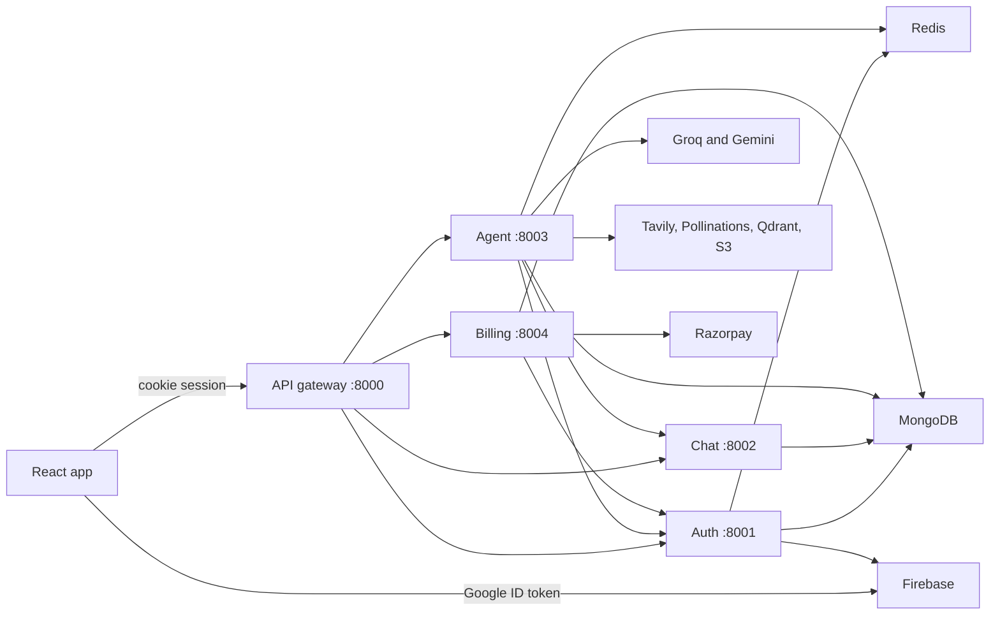

# NexoraAI

NexoraAI is a full-stack AI assistant. Users sign in with Google, chat in saved conversations, and can ask the app to search the web, write code, generate PDFs and slide decks, generate images, or answer questions about an uploaded PDF or image. Usage is metered with credits, and paid plans are checked out through Razorpay.

## Overview

The product is a single-page chat application backed by five Node.js services behind an API gateway.

- The browser authenticates with Firebase Authentication (Google), then exchanges the Firebase ID token for an HTTP-only session cookie.
- Conversations and messages are stored in MongoDB. Short-term chat memory and sessions live in Redis.
- A LangGraph workflow routes each prompt to a specialist agent. Agents call Groq, Google Gemini, Tavily, Pollinations, Qdrant, and Amazon S3 depending on the task.
- Generated images, PDFs, and presentations are uploaded to S3 and returned as presigned URLs. Coding tasks can also return editable file artifacts in the UI.

## Key features

- Google sign-in and a seven-day server session stored in Redis.
- Conversation list with create, rename, load, and delete.
- Agent picker: Auto, Chat, Search, Coding, PDF, PPT, and image generation.
- Automatic routing when Auto is selected. Uploaded PDFs and images override the picker and go to the PDF question-answering and image-analysis agents.
- Web search (Tavily) followed by an answer that uses the search results.
- Code answers in Markdown, plus multi-file project artifacts opened in a Monaco editor panel.
- PDF and PowerPoint generation, uploaded to S3.
- Image generation (Pollinations Flux), cropped and stored in S3.
- PDF retrieval-augmented answers (Qdrant + Gemini embeddings) and image analysis.
- Credit balance, per-agent credit costs, and per-agent rate limits.
- Razorpay checkout for Starter (₹199 / 500 credits) and Pro (₹499 / 1000 credits). New users start on the Free plan with 100 credits.
- Markdown rendering for assistant messages.

The PDF and PPT controls in the chat composer are wired to the **generation** agents. The labels in `frontend/src/components/ChatInput.jsx` describe reading a PDF or PPT. Uploading a PDF or image is what triggers document Q&A and image analysis. PPT upload is not accepted.

## Technology stack

| Area | Technologies |
| --- | --- |
| Frontend | React 19, Vite 8, Tailwind CSS 4, Redux Toolkit, Axios, Firebase client SDK, Monaco Editor, react-markdown, Motion |
| Backend | Node.js 22, Express 5, ESM modules. Gateway plus auth, chat, agent, and billing services |
| Database | MongoDB via Mongoose. Redis via ioredis |
| AI | LangChain, LangGraph, Groq, Google Gemini (chat and embeddings), Tavily search, Pollinations image API, Qdrant |
| Payments | Razorpay |
| Storage | Amazon S3 (generated files). Presigned download URLs |
| Auth | Firebase Authentication (Google) and Firebase Admin |
| DevOps | Docker images per service, GitHub Actions, Amazon ECR, Amazon ECS, S3 static hosting, CloudFront |
| Tools | ESLint (frontend), Nodemon (local backend) |

`@langchain/openrouter` is installed in the agent service, and `OPENROUTER_API_KEY` is listed in `backend/services/agent/.env.example`. No application source file reads that variable or imports the OpenRouter package.

## Architecture



Request path for a chat message:

1. The frontend creates a conversation if needed (`GET /api/chat/create-conversation`).
2. It posts the prompt to `POST /api/agent/chat`. A file is sent as `multipart/form-data`.
3. The gateway requires a valid `sessionId` cookie and forwards `x-user-id`.
4. The agent service saves the user turn, runs the LangGraph router, then saves the assistant turn through the chat service.
5. The graph checks the Redis rate limit, calls the model or external API, and asks the auth service to deduct credits.

Search is a two-step graph: the search node runs first, then the chat node answers from those results. Credits for a successful search are deducted in the search node (5). The chat node skips its own 1-credit deduction when search text is present.

## Repository layout

```text
Nexora-AI/
├── .github/workflows/deploy.yml    # ECR build, ECS rollout, S3 + CloudFront
├── frontend/                       # Vite React client
│   ├── src/components/             # Chat UI, sidebar, billing drawer, artifact panel
│   ├── src/features/               # API calls
│   ├── src/redux/                  # user, conversation, and message state
│   └── utils/                      # Axios client and Firebase client config
└── backend/
    ├── docker-compose.yml          # Redis only
    ├── gateway/                    # Public API, CORS, session check, proxy
    ├── shared/redis/               # Shared Redis client
    └── services/
        ├── auth/                   # Firebase login, users, credits, sessions
        ├── chat/                   # Conversations and messages
        ├── agent/                  # LangGraph agents and file generation
        └── billing/                # Plans, Razorpay orders, payment records
```

There is no database migration tool and no seed script. Mongoose creates collections on first write.

## Prerequisites

- Node.js 22 and npm. Dockerfiles and the deploy workflow use Node 22. The `package.json` files do not set an `engines` field.
- Docker, if you run Redis with Compose.
- A MongoDB database and connection string.
- A Redis instance. Compose in this repo starts one on port 6379.
- A Firebase project with Google sign-in enabled, a web app config, and a service account.
- API credentials for Groq, Google AI (Gemini), Tavily, Pollinations, Qdrant, AWS S3, and Razorpay.

The Firebase web config other than the API key is hardcoded in `frontend/utils/firebase.js`. A different Firebase project requires editing that file. Do not commit `backend/services/auth/ServiceAccountKey.json`.

## Installation

Install the backend root package first. The gateway and agent service load `backend/shared/redis/redis.js`, which imports `ioredis` from the backend root `node_modules`.

```bash
cd backend
npm install

cd gateway
npm install

cd ../services/auth
npm install

cd ../chat
npm install

cd ../agent
npm install

cd ../billing
npm install

cd ../../../frontend
npm install
```

Start Redis:

```bash
cd backend
docker compose up -d
```

`backend/docker-compose.yml` publishes Redis on `6379` and does not start the Node services.

## Environment variables

Copy each example file to `.env` in the same directory. `.env` files are gitignored. Values below are placeholders.

Set the ports in the table. Several example files and code defaults do not match the gateway or the Dockerfiles. If `PORT` is left unset, auth, chat, and billing all fall back to `8001`, and the agent service falls back to `8002`.

| Service | Port to use locally | Code default if `PORT` is unset | `Dockerfile` `EXPOSE` | Example file |
| --- | --- | --- | --- | --- |
| Gateway | 8000 | 8000 | 8000 | `PORT=8000` |
| Auth | 8001 | 8001 | 8001 | `PORT=8001` |
| Chat | 8002 | 8001 | 8002 | `PORT=8001` (does not match the gateway) |
| Agent | 8003 | 8002 | 8003 | `PORT=8002` (does not match the gateway) |
| Billing | 8004 | 8001 | 8004 | No example file in the repo |

### Frontend — `frontend/.env`

From `frontend/.env.example`:

```env
VITE_SERVER_URL=http://localhost:8000
VITE_FIREBASE_API_KEY=
```

The deploy workflow also requires a GitHub secret named `VITE_RAZORPAY_KEY_ID`. The frontend source does not read that variable. Checkout uses the key returned by `POST /api/billing/create`.

### Gateway — `backend/gateway/.env`

From `backend/gateway/.env.example`:

```env
PORT=8000
FRONTEND_URL=http://localhost:5173
AUTH_SERVICE=http://localhost:8001
CHAT_SERVICE=http://localhost:8002
AGENT_SERVICE=http://localhost:8003
BILLING_SERVICE=http://localhost:8004
REDIS_URL=redis://127.0.0.1:6379
```

`FRONTEND_URL` is the CORS origin and must match the browser origin exactly. The gateway session middleware reads Redis through `REDIS_URL` (or `REDIS_HOST`).

### Auth — `backend/services/auth/.env`

From `backend/services/auth/.env.example`:

```env
PORT=8001
NODE_ENV=development
MONGO_URI=mongodb://127.0.0.1:27017/nexora
REDIS_URL=redis://127.0.0.1:6379
```

`NODE_ENV` is not read by the auth service. The session cookie is always `HttpOnly`, `Secure`, and `SameSite=None`.

Firebase Admin credentials, in either form:

- `backend/services/auth/ServiceAccountKey.json`, copied from `ServiceAccountKey.json.example` and filled with the real service account, or
- `FIREBASE_PROJECT_ID`, `FIREBASE_CLIENT_EMAIL`, and `FIREBASE_PRIVATE_KEY` (use `\n` for newlines in the private key).

The JSON file is preferred when it exists.

### Chat — `backend/services/chat/.env`

The committed example sets `PORT=8001`. Use `8002` so it matches the gateway:

```env
PORT=8002
MONGO_URI=mongodb://127.0.0.1:27017/nexora
REDIS_URL=redis://127.0.0.1:6379
```

The chat service does not connect to Redis. `REDIS_URL` in its example file is unused.

### Agent — `backend/services/agent/.env`

The committed example sets `PORT=8002`. Use `8003`. These names are read by the agent code or listed for the libraries it calls:

```env
PORT=8003
MONGO_URI=mongodb://127.0.0.1:27017/nexora
CHAT_SERVICE=http://localhost:8002
AUTH_SERVICE=http://localhost:8001
GROQ_API_KEY=
GOOGLE_API_KEY=
TAVILY_API_KEY=
POLLINATIONS_API_KEY=
QDRANT_ENDPOINT=
QDRANT_API_KEY=
REDIS_URL=redis://127.0.0.1:6379
AWS_REGION=
AWS_ACCESS_KEY_ID=
AWS_SECRET_ACCESS_KEY=
AWS_BUCKET_NAME=
```

Notes:

- `QDRANT_URL` is accepted as an alias of `QDRANT_ENDPOINT`.
- `GEMINI_API_KEY` is accepted as an alias of `GOOGLE_API_KEY` for embeddings only. Chat still reads `GOOGLE_API_KEY`.
- `TAVILY_API_KEY` is not passed in code. `TavilySearch` is constructed without an API key argument, so the key must be present in the environment for that library.
- AWS variables are required for image, PDF, and PPT generation. They are not listed in `backend/services/agent/.env.example`.
- `OPENROUTER_API_KEY` is in the example file and is unused by current source.

The agent loads `backend/services/agent/.env` with `override: true`.

### Billing — `backend/services/billing/.env`

There is no billing example file. The service reads:

```env
PORT=8004
MONGO_URI=mongodb://127.0.0.1:27017/nexora
RAZORPAY_KEY_ID=
RAZORPAY_KEY_SECRET=
AUTH_SERVICE=http://localhost:8001
```

## Run locally

Start Redis and confirm MongoDB is reachable. Then start each service in its own terminal. Order does not matter at boot. The agent calls chat and auth when a message is handled, and billing calls auth after a payment is verified.

```bash
cd backend/services/auth
npm run dev
```

```bash
cd backend/services/chat
npm run dev
```

```bash
cd backend/services/agent
npm run dev
```

```bash
cd backend/services/billing
npm run dev
```

```bash
cd backend/gateway
npm run dev
```

```bash
cd frontend
npm run dev
```

`npm run dev` uses Nodemon on the backend and Vite on the frontend. `npm start` runs the backend with `node` and no reload. Vite’s default URL is `http://localhost:5173`, which matches `FRONTEND_URL` in the gateway example.

Production images use `npm start` and expect `PORT` to be set to the exposed port (`8000`–`8004`). The Dockerfiles do not set `PORT` themselves.

## Docker

Each service has its own Dockerfile. Build context is the `backend` directory.

```bash
docker build -f backend/gateway/Dockerfile -t gateway backend
docker build -f backend/services/auth/Dockerfile -t auth-service backend
docker build -f backend/services/chat/Dockerfile -t chat-service backend
docker build -f backend/services/agent/Dockerfile -t agent-service backend
docker build -f backend/services/billing/Dockerfile -t billing-service backend
```

Images are based on `node:22-alpine`. There is no Compose file that runs the full stack. Container environment variables, task networking, and the production Redis and MongoDB hosts are not defined in this repository.

## Database

MongoDB is shared by connection string. These collections are created by Mongoose when documents are inserted:

| Model | Service | Contents |
| --- | --- | --- |
| `User` | Auth | Firebase uid, name, email, avatar, plan, credits, total credits, plan expiry |
| `Conversation` | Chat | Title (default `New Conversation`) and `userId` |
| `Message` | Chat | Role (`user` or `assistant`), content, image URLs, S3 file descriptors, code artifacts |
| `Payment` | Billing | Razorpay order id, payment id, amount, currency (`INR`), credits, plan, status (`created`, `paid`, `failed`) |

Redis keys:

| Key | TTL | Purpose |
| --- | --- | --- |
| `session:{sessionId}` | 7 days | Session payload |
| `user-session:{userId}` | 7 days | Current session id. Login replaces the previous session |
| `messages:{conversationId}` | 24 hours | Last 20 chat turns used as model memory |
| `rate:{agent}:{userId}` | 60 seconds | Per-agent request counter |

No migration or seed command exists.

## API

The browser calls the gateway. Protected routes require the `sessionId` cookie (`withCredentials` is enabled on the Axios client). The gateway copies the session user id into the `x-user-id` header for chat, agent, and billing.

`/api/auth` is proxied with no session check. That includes login and logout, and also the internal credit and plan routes.

### Auth

`POST /api/auth/login`

Body:

```json
{ "token": "<Firebase ID token>" }
```

Success `200`:

```json
{
  "message": "Login successful",
  "user": {
    "name": "Ava Shah",
    "email": "ava@example.com",
    "plan": "free",
    "credits": 100,
    "totalCredits": 100
  },
  "sessionId": "generated-session-id"
}
```

The response also sets the `sessionId` cookie. `400` if `token` is missing. `401` if Firebase rejects the token.

`POST /api/auth/logout` clears the cookie and deletes the Redis session. Success `200`: `{ "message": "Logout successful" }`.

`GET /api/me` uses a soft session lookup. Success `200`: `{ "user": null }` when logged out, or the session payload when logged in (`userId`, `name`, `email`, `avatar`, `plan`, `credits`, `totalCredits`, `planExpiersAt`).

Internal auth routes, called by other services and also reachable on the gateway without a session cookie:

`POST /api/auth/deduct-credits`

```json
{ "userId": "<mongo user id>", "agentType": "chat" }
```

`POST /api/auth/update-plan`

```json
{ "userId": "<mongo user id>", "plan": "starter", "credits": 500 }
```

Plan updates add credits and set expiry to 30 days from the update.

### Chat

All chat routes require a session.

| Method | Path | Body or params | Success |
| --- | --- | --- | --- |
| `GET` | `/api/chat/create-conversation` | — | `201` `{ "success": true, "conversation": { ... } }` |
| `GET` | `/api/chat/get-conversations` | — | `200` `{ "success": true, "conversations": [] }` |
| `POST` | `/api/chat/update-conversation` | `{ "conversationId", "title" }` | `200` updated conversation. `400` if `conversationId` is missing |
| `GET` | `/api/chat/get-messages/:conversationId` | — | `200` `{ "success": true, "messages": [] }` |
| `DELETE` | `/api/chat/delete-conversation/:conversationId` | — | `200` `{ "success": true, "conversationId" }` if the conversation belongs to `x-user-id` |

`POST /api/chat/save-message` is used by the agent service (`conversationId`, `role`, `content`, optional `images`, `artifacts`, `files`). It is also exposed through the authenticated chat proxy.

### Agent

`POST /api/agent/chat` requires a session. Timeout at the gateway is 10 minutes. The frontend uses the same timeout.

JSON body:

```json
{
  "prompt": "Explain how Redis keys expire",
  "conversationId": "<mongo conversation id>",
  "agent": "auto"
}
```

With a file, send `multipart/form-data` fields `prompt`, `conversationId`, `agent`, and `file`. The server accepts `image/*` and `application/pdf` only. The UI rejects files larger than 20 MB. Multer itself has no size limit in code.

`agent` values accepted from the client: `auto` (also `agent` or empty), `chat`, `search`, `coding`, `pdf`, `ppt`, `imageGen` (also `image` or `imagegen`). An uploaded PDF forces `pdfRAG`. An uploaded image forces `imageAnalyzer`.

Success `200`:

```json
{
  "message": "Assistant reply text",
  "conversationId": "<mongo conversation id>",
  "images": ["https://example-bucket.s3.amazonaws.com/images/....jpg"],
  "artifacts": [{ "name": "index.js", "type": "javascript", "content": "console.log('hello')" }],
  "files": [{ "kind": "pdf", "title": "JavaScript", "url": "https://...", "fileName": "JavaScript.pdf" }],
  "searchResults": null
}
```

`402` is what the UI treats as insufficient credits. The agent error handler returns `INSUFFICIENT_CREDITS` without setting a status, so the HTTP status for that case is `500` unless another layer changes it. `429` with `code: "RATE_LIMIT_EXCEEDED"` when the one-minute limit is hit.

Credit cost and rate limit (requests per user per 60 seconds):

| Agent | Credits | Limit per minute |
| --- | --- | --- |
| Chat | 1 | 20 |
| Search | 5 | 5 |
| Coding | 10 | 20 |
| PDF generation | 10 | 5 |
| PPT generation | 10 | 5 |
| Image generation | 10 | 5 |
| Image analysis | 10 | 10 |
| PDF question answering | 10 | 5 |

Unknown `agentType` values cost 1 credit. If Redis is down, the rate limiter logs the error and allows the request. Login still requires Redis.

### Billing

All billing routes require a session.

`GET /api/billing/plans` returns the Free, Starter, and Pro plans (`id`, `name`, `amount` in INR, `credits`, `validity` in days).

`POST /api/billing/create`

```json
{ "plan": "pro" }
```

Success `200` includes the Razorpay order, the selected plan, and `key` (the Razorpay key id). Free cannot be purchased (`400`). Unknown plan ids return `404`.

`POST /api/billing/verify`

```json
{
  "razorpay_order_id": "order_example",
  "razorpay_payment_id": "pay_example",
  "razorpay_signature": "<hmac signature>"
}
```

The service checks the signature with `RAZORPAY_KEY_SECRET`, marks the payment `paid`, and calls auth `POST /update-plan`. Success `200` returns `plan`, `credits`, `totalCredits`, and `planExpiersAt`.

## AI models and integrations

Model ids below are the strings in `backend/services/agent/config/llmModels.js` and the related agent files.

| Task | Provider and model |
| --- | --- |
| Router, search, PPT, image-prompt writing | Groq, `openai/gpt-oss-120b` |
| Coding and PDF document JSON | Same Groq model, higher `maxTokens` |
| Chat answers, including answers after search | Google Gemini, `gemini-3.5-flash` |
| Image analysis | Groq, `qwen/qwen3.8-27b` |
| PDF embeddings | Google `gemini-embedding-001`, 768 dimensions |
| Web search | Tavily, up to 5 results, 45 second timeout |
| Image generation | Pollinations `flux` at `https://image.pollinations.ai`, then S3 |
| PDF and PPT files | Generated in process (`pdfkit`, `pptxgenjs`) and uploaded to S3 |
| Vector search | Qdrant collection `pdf-{timestamp}` per upload, top 5 chunks |

Chat memory sent to the model is capped at 20 messages. Generated image URLs are presigned for 7 days. PDF and PPT download URLs use the `getFromS3` default of 10 minutes.

## Scripts

These commands come from the `package.json` files. They were not executed as part of writing this document.

| Location | Command | What it does |
| --- | --- | --- |
| `frontend` | `npm run dev` | Vite dev server |
| `frontend` | `npm run build` | Production build to `frontend/dist` |
| `frontend` | `npm run preview` | Serve the production build |
| `frontend` | `npm run lint` | ESLint |
| Each backend service | `npm run dev` | Nodemon |
| Each backend service | `npm start` | `node index.js` |
| `backend` | `npm test` | Prints an error and exits 1. No tests are defined |

There is no test runner, test script, or CI test job in the frontend or the services.

## Deployment

`.github/workflows/deploy.yml` runs on every push to `main`.

Backend job:

1. Configures AWS credentials and logs in to ECR.
2. Writes `backend/services/auth/ServiceAccountKey.json` from the `FIREBASE_SERVICE_ACCOUNT` secret and checks that it is valid JSON.
3. Builds and pushes `gateway`, `auth-service`, `chat-service`, `agent-service`, and `billing-service`, each tagged `latest`.
4. Calls `aws ecs update-service --force-new-deployment` for five services in one cluster.

Frontend job (after the backend job):

1. Uses Node.js 22 and `npm ci` in `frontend`.
2. Fails if `VITE_FIREBASE_API_KEY`, `VITE_RAZORPAY_KEY_ID`, or `VITE_SERVER_URL` secrets are empty.
3. Runs `npm run build`.
4. Syncs `frontend/dist` to the S3 bucket with `--delete`.
5. Creates a CloudFront invalidation for `/*`.

GitHub Actions secret names used by the workflow:

`AWS_REGION`, `AWS_ACCOUNT_ID`, `AWS_ACCESS_KEY`, `AWS_SECRET_ACCESS_KEY`, `FIREBASE_SERVICE_ACCOUNT`, `ECS_CLUSTER`, `GATEWAY_SERVICE`, `AUTH_SERVICE`, `CHAT_SERVICE`, `AGENT_SERVICE`, `BILLING_SERVICE`, `VITE_FIREBASE_API_KEY`, `VITE_RAZORPAY_KEY_ID`, `VITE_SERVER_URL`, `S3_BUCKET`, `CLOUDFRONT_DISTRIBUTION_ID`.

ECR repository names in the workflow are `gateway`, `auth-service`, `chat-service`, `agent-service`, and `billing-service`. ECS task definitions, load balancer rules, and runtime environment variables are not in this repository. Those have to already exist in AWS.

## Troubleshooting

**Google sign-in succeeds but the app stays on the login dialog.** The session cookie is always `Secure` and `SameSite=None`. Browsers do not store that cookie on `http://localhost`. The API must be served over HTTPS, or the cookie flags in `backend/services/auth/controllers/auth.controllers.js` have to allow local HTTP. `NODE_ENV` does not change this behavior.

**Browser requests fail CORS.** `FRONTEND_URL` on the gateway must be the exact Vite origin, including port.

**Login returns 500 and the auth log mentions Firebase.** `ServiceAccountKey.json` is missing and the `FIREBASE_*` environment variables are incomplete.

**Gateway or agent cannot connect to Redis.** Install dependencies in `backend/` so `ioredis` resolves, and run Redis on `REDIS_URL`. Auth will not create a session without Redis.

**Chat, agent, and billing do not receive traffic.** Their `PORT` values must match `CHAT_SERVICE`, `AGENT_SERVICE`, and `BILLING_SERVICE` on the gateway. Do not rely on the chat and agent example ports or on the billing default.

**Image, PDF, or PPT generation fails after the model responds.** `AWS_REGION`, `AWS_ACCESS_KEY_ID`, `AWS_SECRET_ACCESS_KEY`, and `AWS_BUCKET_NAME` must be set on the agent service. PDF question answering also needs `QDRANT_ENDPOINT` and a Google API key for embeddings.

**Payment verification fails.** `RAZORPAY_KEY_SECRET` on the billing service must be the secret that matches the key id returned to the browser. `AUTH_SERVICE` must be reachable from the billing service at `/update-plan`.

## Known limitations

- No automated tests.
- Local ports in `backend/services/chat/.env.example` and `backend/services/agent/.env.example` disagree with the gateway example and the Dockerfiles. Billing has no example env file and defaults to port `8001`.
- Credit and plan update routes are on the public auth proxy without a session check.
- Insufficient credits are not given a dedicated HTTP status by the agent error handler. The UI also looks for `402`.
- PDF and PPT buttons in the UI are labeled like file-reading modes. The matching agents generate files. Only image and PDF uploads are implemented.
- `OPENROUTER_API_KEY` and the OpenRouter dependency are unused.
- ECS service configuration is outside this repo, so a green workflow still depends on existing AWS resources.
- Presigned PDF and PPT URLs expire after 10 minutes. Image URLs expire after 7 days.

## Contributing

There is no separate contributing guide. For a change:

1. Keep secrets out of git. `.env` files and `ServiceAccountKey.json` are ignored.
2. Run `npm run lint` in `frontend` before opening a frontend change.
3. Describe behavior in the commit subject. This repo’s commit style is one imperative line, at most 60 characters, with no file list.

## License and author

Service `package.json` files declare the `ISC` license. The repository has no `LICENSE` file, and the `author` fields are empty. Add a license file if you intend to publish the project.
